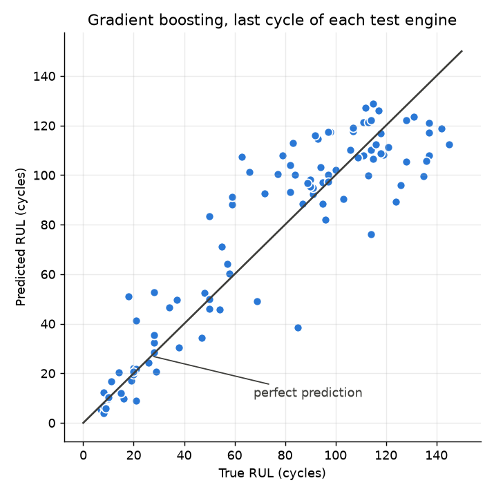
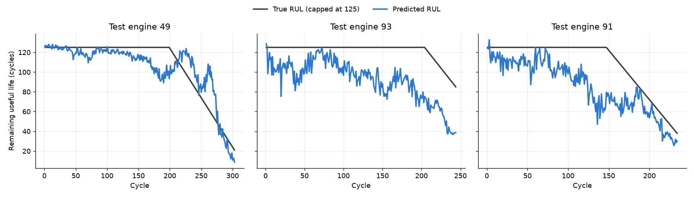

# Predicting when a jet engine needs maintenance

Remaining-Useful-Life (RUL) prediction for turbofan engines using NASA's C-MAPSS dataset.

## The problem
A jet engine wears out gradually, and its sensors drift as it does. Remaining useful life (RUL) is the number of flight cycles an engine has left before it fails. Predicting it from sensor readings means maintenance can be planned before a problem occurs, which reduces unplanned removals and improves safety and cost.

This project trains models to predict RUL from simulated engine sensor data.

## Dataset
NASA C-MAPSS *Turbofan Engine Degradation Simulation*, subset **FD001** (one operating condition, one fault mode).

Each file has 26 space-separated columns and no header:

| File column | Name in code | What it is |
|-------------|--------------|------------|
| 1 | `unit` | engine id |
| 2 | `cycle` | time step (one flight cycle) |
| 3–5 | `op_setting_1` … `op_setting_3` | operational settings |
| 6–26 | `sensor_1` … `sensor_21` | sensor readings (file column = sensor number + 5) |

The raw files are not committed. To reproduce:
1. Download the C-MAPSS dataset from the [NASA Prognostics Data Repository](https://www.nasa.gov/intelligent-systems-division/discovery-and-systems-health/pcoe/pcoe-data-set-repository/).
2. Put the unzipped `CMaps` folder inside `data/`.

## Method
1. **Explore.** Plot every column against cycle ([sensors_vs_cycle.png](figures/sensors_vs_cycle.png)).
2. **Drop 10 columns** that carry no wear signal: the constant sensors 1, 5, 10, 16, 18 and 19, sensor 6 (only flips between 21.60 and 21.61), and the three operational settings (FD001 has a single operating condition). 14 sensors remain.
3. **Label.** RUL = engine's last cycle − current cycle, capped at 125. Early in life the sensors look healthy, so the difference between 200 and 300 cycles left can't be learned.
4. **Scale.** MinMax scaling, fitted on training data only to avoid leakage.
5. **Baseline.** Linear regression on the sensors.
6. **Rolling features.** Per-engine trailing mean and standard deviation of each sensor. The window (10, 20 or 30 cycles) was chosen by 5-fold cross-validation grouped by engine on the training set.
7. **Tree models.** Random forest and gradient boosting.
8. **Evaluate.** Predict at the last recorded cycle of each of the 100 test engines and compare with `RUL_FD001.txt`.

## Results
Test set: last cycle of the 100 FD001 test engines. Lower is better for every metric. Seeds are fixed, so `python src/train.py` reproduces these numbers.

| Model | Features | Test RMSE (cycles) | RMSE, true RUL capped at 125 | NASA score |
|-------|----------|--------------------|------------------------------|------------|
| Linear regression (baseline) | sensors only | 21.90 | 20.82 | 1313.99 |
| Random forest | sensors only | 18.35 | 17.36 | 938.15 |
| Gradient boosting | sensors only | 18.54 | 17.62 | 1066.18 |
| Linear regression | sensors + rolling 30 | 18.99 | 17.72 | 675.29 |
| Random forest | sensors + rolling 30 | 18.19 | 17.03 | 708.24 |
| **Gradient boosting** | **sensors + rolling 30** | **17.15** | **15.95** | **521.50** |

The NASA score penalises predicting failure too late more heavily than too early.





## How to run
```bash
python -m venv .venv
.venv\Scripts\activate
pip install -r requirements.txt
python src/train.py
```

## Project layout
```
data/            raw C-MAPSS files (not committed)
notebooks/       exploration
src/data.py      loading, RUL labels, dropping flat sensors
src/explore.py   sensor plots and per-column variation
src/features.py  rolling features
src/train.py     models, RMSE table, plots
figures/         saved plots
```

## What I learned
1. **Understanding the data matters more than the model.** Before making any modelling decisions, I plotted every FD001 sensor against cycle to see which ones actually showed signs of wear. I dropped 10 columns that carried no signal, such as constant sensors and sensor_6, which only flipped between 21.60 and 21.61. I learned not to judge a sensor by its standard deviation: sensor_13 and sensor_15 barely moved in raw numbers but clearly trended towards failure, so I judged each sensor by whether it changed as the engine wore out.

2. **Preventing data leakage.** The model must never use information it wouldn't have in the real world, or its score looks better than it really is. I fitted the scaler on training data only, and made the rolling features restart for each engine and only look backwards. Without that, engine 2's first rolling value would have included engine 1's final, near-failure cycles, making a brand-new engine look worn out.

3. **Better features can matter as much as a better model.** Giving the model a 30-cycle rolling average and standard deviation of each sensor, alongside the single noisy reading, improved linear regression's RMSE from 21.90 to 18.99 cycles, while the random forest barely changed (18.35 to 18.19) because averaging many trees already smooths out noise. Combining rolling features with gradient boosting gave the best result, an RMSE of 17.15.

## What I'd do next
1. **Handle multiple operating conditions (FD002 and FD004).** These subsets run under six operating conditions, and switching condition shifts the sensor readings more than wear does. I would keep the operational settings, use them to group each row by condition, and scale every sensor within its own condition so the wear trend shows through again.

2. **Add a second fault mode (FD003 and FD004).** These engines can fail through fan degradation as well as compressor degradation, so different sensors may carry the warning signs. I would re-run the exploration step to check which sensors to keep, rather than reusing the FD001 choices.

3. **Try sequence models (LSTM or 1D-CNN).** My rolling features are a hand-made summary of each engine's recent history. A sequence model reads the raw window of readings directly and could learn patterns that a mean and standard deviation miss, such as how quickly a sensor is accelerating.

4. **Make the evaluation and the predictions safer.** I would set aside a final hold-out set that is scored only once, so every model choice is made without seeing it. I would also push the model to err towards predicting failure early, for example by training against the NASA score, because a late prediction means an engine flies past the point where it should have been maintained.
